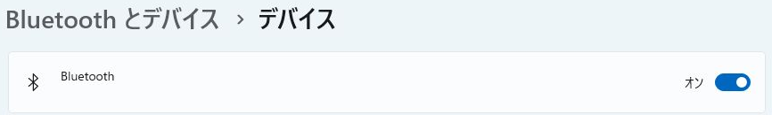
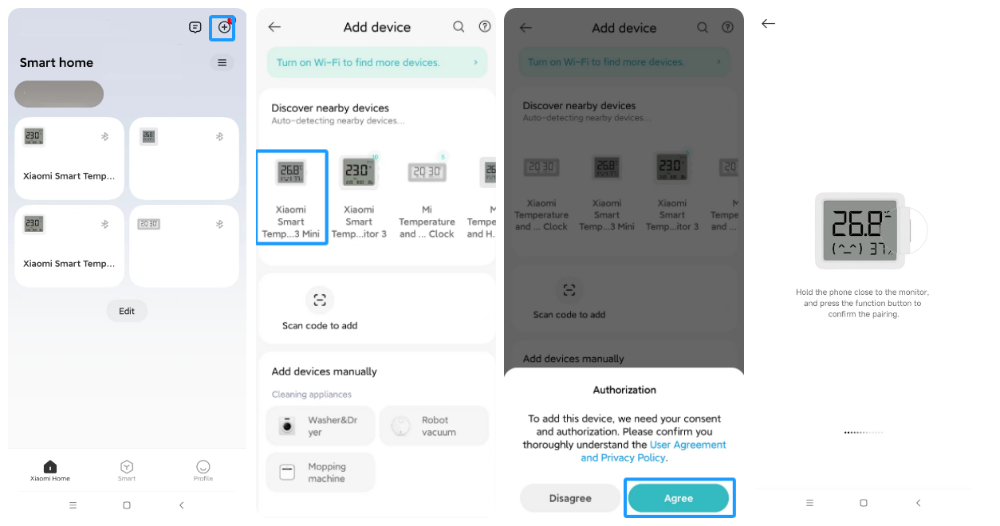
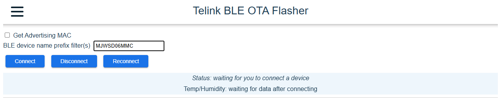

# XiaomiのBluetooth温湿度計をBTHome化する

[手順の概要](./overview.ja.md) · [English guide](./overview.en.md)

XiaomiのBluetooth温湿度計にpvvxファームウェアを書き込み、温度と湿度をBTHome v2でHome Assistantに取り込む手順です。純正ファームウェアへ戻す方法は手順5にまとめています。

## 対象機種と選んだ理由

対象は **Xiaomi スマート温湿度計 3 Mini**（型番 `MJWSD06MMC`、製品番号 `QBH4312GL`）です（[公式仕様](https://www.mi.com/jp/product/xiaomi-smart-temperature-and-humidity-monitor-3-mini/specs/) / [技適表示のある取扱説明書](https://www.mi.com/jp/support/user-guide-pdf/xiaomi-%E3%82%B9%E3%83%9E%E3%83%BC%E3%83%88%E6%B8%A9%E6%B9%BF%E5%BA%A6%E8%A8%88-3-mini/)）。国内で手に入りやすく、技適マークが付いている候補を比べたところ、購入時点で最も安価でした。

## BTHome化する理由

純正ファームウェアのままでは、Xiaomi Homeアプリを頻繁に操作する必要がありました。普段の確認をHome Assistantにまとめるため、Bluetoothで測定値を送る公開仕様の [BTHome](https://bthome.io/) に切り替えました。書き換え後は、Home Assistantの [BTHome統合](https://www.home-assistant.io/integrations/bthome/) で測定値を直接受信できます。

## 検証した実機と結果

2026年11月25日に、実機の `MJWSD06MMC`（ハードウェア `V1.3`、ファームウェア・ソフトウェアともリビジョン `0009`）へpvvxの `MJ6_v59.bin` をBluetoothで書き込みました。Home AssistantにBTHome機器として追加し、温度と湿度が更新されることを確認しています（[確認記録の詳細](./overview.ja.md)）。

今回の作業では純正ファームウェアのバックアップを行っておらず、純正への書き戻しは未検証です。

## 0. 準備するもの

| 用意するもの | 状態・要件 |
| --- | --- |
| 温湿度計 | 型番 `MJWSD06MMC`（電池を入れ、液晶に温度と湿度が表示される状態） |
| スマートフォン | Xiaomi Homeアプリが使える状態（登録するアカウントと地域を確認しておく） |
| Windows PC | Bluetoothがオンの環境と、ChromeまたはEdge |
| Home Assistant | 稼働中の環境と、[Bluetooth受信環境](https://www.home-assistant.io/connectivity/bluetooth/)（本体のBluetoothアダプターまたは対応プロキシ） |

Windows 11では **設定 → Bluetooth とデバイス → デバイス** でBluetoothをオンにしておきます。OS側でのペアリングは不要で、温湿度計には手順2のツールから直接接続します。

*図1: Windows 11のBluetooth設定画面*

## 1. 純正ファームウェアの認証情報を取得する

### 1.1 Xiaomi Homeに温湿度計を登録する

1. スマートフォンを温湿度計に近づけ、**Xiaomi Home** を開きます（登録済みなら1.2へ進みます）。
2. 右上の **＋** から機器の追加を選び、見つかった **Xiaomi Smart Temperature and Humidity Monitor 3 Mini** をタップします。
3. 画面の案内に従って登録を完了します。本体ボタンを押すよう表示されたら、側面のボタンを短く押します（約7秒長押しすると初期化されます。参考: [Xiaomi公式FAQ](https://www.mi.com/global/support/faq/details/KA-573296/)）。

*図2: Xiaomi Homeでの機器追加画面（出典: [Xiaomi公式FAQ](https://www.mi.com/global/support/faq/details/KA-573296/)）*

### 1.2 Xiaomi Cloud Tokens Extractorでキーを取得する

1. [Xiaomi Cloud Tokens Extractor v1.5.1](https://github.com/PiotrMachowski/Xiaomi-cloud-tokens-extractor/releases/tag/v1.5.1) のリリースページを開き、**Assets** から **`token_extractor.exe`** をダウンロードします。

   

   *図3: リリースページのAssetsにある `token_extractor.exe`*

2. `token_extractor.exe` を起動し、`p/q:` と表示されたら `q` を入力してEnterを押します。
3. 表示されたQRコードをスマートフォンで読み取り、温湿度計を登録したXiaomiアカウントでサインインを承認します。
4. `Select server` と出たら、Xiaomi Homeの地域コードを入力します。分からない場合は空欄のままEnterを押すと全地域を検索します。
5. 一覧から対象の温湿度計を探し、**`TOKEN`** と **`BLE KEY`** を控えます（[ツールの出力仕様](https://github.com/PiotrMachowski/Xiaomi-cloud-tokens-extractor/blob/v1.5.1/token_extractor.py)）。

| 出力項目 | 形式 | Flasherの入力先 |
| --- | --- | --- |
| `TOKEN` | 16進数24文字 | **Mi Token** |
| `BLE KEY` | 16進数32文字 | **Mi Bind Key** |

同型機が複数ある場合は、`NAME` や `MAC`（Bluetoothアドレス）で対象を見分けます。アドレスが分からないときは、温湿度計を受信機の近くに置いて側面ボタンを短く押し、Home Assistantの [Bluetooth Advertisement Monitor](https://www.home-assistant.io/connectivity/bluetooth/#advertisement-monitor) で確認できます。

QRコードや取得したキー、出力結果は外部に公開せず、手元だけで管理してください。温湿度計を初期化して再登録した場合は、キーを取得し直します（[開発元スレッドの事例](https://github.com/pvvx/ATC_MiThermometer/issues/636)）。

## 2. pvvxファームウェアを書き込む

### 2.1 書き込む前の注意点

同じ型番 `MJWSD06MMC` でも搭載センサーが異なる基板があり（[基板資料](https://pvvx.github.io/MJWSD06MMC/)）、`V1.3` / `0009` でのGATT接続エラーや、書き換え後に無応答になった事例が報告されています（[OTAスレッド](https://github.com/pvvx/ATC_MiThermometer/issues/636) / [無応答の事例](https://github.com/pvvx/ATC_MiThermometer/discussions/814)）。

Bluetoothでつながらなくなった場合、復旧にはケースの分解と基板への配線が必要になります（手順5.2）。書き込む前に、手順2.2の接続ログで機器のリビジョンを確かめ、復旧方法も確認しておいてください。

| 確認項目 | 検証した実機の値 |
| --- | --- |
| 型番 | `MJWSD06MMC` |
| ハードウェアリビジョン | `V1.3` |
| ファームウェア / ソフトウェアリビジョン | いずれも `0009` |
| 純正配信のMiBeacon製品ID | `0x5BEA` |

`0009` は開発元の純正 `2.1.1_0009` 向けOTA手順と一致します（Xiaomi Home上の完全な版数は未確認です）。なお、`0x5BEA` は配信上の製品IDであり、基板の種類までは判別できません。

### 2.2 Flasherで接続してログインする

**Flasher** は、ブラウザーからBluetoothで温湿度計に接続し、ファームウェアの書き込みや設定を行うpvvxのWebツールです。

1. 温湿度計をWindows PCの近くに置き、スマートフォンのXiaomi Homeで機器の詳細画面を閉じます。
2. ChromeまたはEdgeで [pvvx Telink BLE OTA Flasher](https://pvvx.github.io/ATC_MiThermometer/TelinkMiFlasher.html) を開き、**BLE device name prefix filter(s)** に `MJWSD06MMC` を入力します。

   

   *図4: フィルターに `MJWSD06MMC` を入力した接続前の画面（Flasher v14.4）*

3. **Connect** を押し、ブラウザーの一覧から `MJWSD06MMC` を選びます。見つからない場合は、温湿度計の側面ボタンを短く押してからやり直します。
4. 接続ログで `MJWSD06MMC` と各リビジョン（`Hardware` / `Firmware` / `Software Revision String`）を確かめます。想定と異なる場合や接続エラーが出る場合は、ここで中止します。
5. **Mi Token** に `TOKEN`（24文字）、**Mi Bind Key** に `BLE KEY`（32文字）を入力し（**Device known id** は空欄のまま）、**Login** を押します。
6. ログに `Login successful` と出たらログイン完了です。うまくいかない場合は書き込みに進まず、手順4を参照してください。

*図5: Flasherの認証欄と接続ログの例（出典: [pvvxの案内スレッド](https://github.com/pvvx/ATC_MiThermometer/issues/636)）*

### 2.3 ファームウェアを書き込む

1. **Custom Firmware** のボタンから、対象向けの **`MJ6_vNN.bin`** を読み込みます（`NN` はバージョン番号）。手元のファイルを使う場合は、pvvxのBLE OTA用バイナリを取得して **Select Firmware** から指定します（[ファイル案内](https://github.com/pvvx/ATC_MiThermometer#firmware-binaries) / [ファームウェア一覧](https://github.com/pvvx/ATC_MiThermometer/blob/master/firmware.json)）。
   - **Zigbee Firmware**、**ZB Firmware**、**Original OTA** は別用途のため選びません。
2. **Start Flashing** の横に読み込んだ `MJ6_vNN.bin` が表示されていることを確かめ、**Start Flashing** を押します。

   

   *図6: 書き込み前の画面例（画像は `MJ6_v51.bin` の例。出典: [pvvxの案内スレッド](https://github.com/pvvx/ATC_MiThermometer/issues/636)）*

3. 書き込み中は電池を抜かず、PCの近くに置いたままブラウザーのページを閉じずに待ちます。
4. ログに `Update done after … seconds` と表示されたら書き込み完了です。温湿度計が再起動するまで少し待ちます（エラーや無応答の場合は手順4を参照してください）。

   

   *図7: 書き込み完了時のログ例。`Update done` が完了の目印（出典: [pvvxの案内スレッド](https://github.com/pvvx/ATC_MiThermometer/issues/636)）*

## 3. BTHome v2を設定し、Home Assistantに追加する

### 3.1 配信形式をBTHome v2に切り替える

1. Flasherの **BLE device name prefix filter(s)** を `MJ6` に変え、**Connect** から再起動後の `MJ6_…` に接続します。
2. **Configuration** の **Advertising type** を **BTHome v2** にします（[BTHome v2仕様](https://bthome.io/format/)）。
3. キー入力を省きたい場合は **Encrypted beacon** のチェックを外します（暗号化を外すと、電波が届く範囲では第三者も測定値を読めます）。暗号化を使う場合はオンのままにし、**Get BindKey** で表示される16進数32文字のキーを控えておきます（[Home Assistantの暗号化設定](https://www.home-assistant.io/integrations/bthome/#bindkey)）。
4. **Send Config** を押して設定を反映し、上部の **Disconnect** で切断します。

*図8: BTHome v2の設定画面（テスト値での表示例）。配信形式・暗号化・設定送信の3か所を操作します*

### 3.2 Home Assistantに追加する

1. 温湿度計をHome Assistant側のBluetooth受信機（アダプターまたは対応プロキシ）の近くに置きます。
2. Home Assistantの **設定 → デバイスとサービス → 統合** を開きます。**検出済み** に **BTHome** 機器が表示されていれば **追加** を押します。
   - 表示されていない場合は、右下の **統合を追加** から `BTHome` を検索して対象を選びます。候補が出ないときは手順4を参照してください。
3. 暗号化を有効にした場合は、求められたときに3.1で控えたキーを入力します。必要に応じて名前とエリアを設定して完了します（[BTHome統合ガイド](https://www.home-assistant.io/integrations/bthome/) / [統合の追加手順](https://www.home-assistant.io/getting-started/integration/)）。

*図9: Home Assistantの統合画面例（表示機器は別の製品。出典: [Home Assistant公式ブログ](https://www.home-assistant.io/blog/2022/08/03/release-20228/#first-class-bluetooth-support)）*

### 3.3 測定値の更新を確かめる

1. **設定 → デバイスとサービス → デバイス** から追加した温湿度計を開き、温度・湿度（表示されていればバッテリー残量も）が本体の液晶表示と合っていることを確かめます。
2. 温湿度が少し変わったときにHome Assistant側も更新されること、さらに実際の設置場所でも更新されることを確かめて完了です。

実機では再起動後にHome Assistantが自動検出し、`MJ6 D95B` として追加できました。2026年11月25日（JST）の計測では、約25秒の間に次のとおり値が更新されました。

| 項目 | 06:01:05 | 06:01:30 |
| --- | --- | --- |
| 温度 | 27.48 °C | 27.43 °C |
| 湿度 | 45.49% | 45.53% |

## 4. つまずいたときの対処

| 症状 | 対処 |
| --- | --- |
| Extractorに温湿度計が出ない | Xiaomi Homeのアカウントと地域が合っているか見直します。地域が分からない場合は `Select server` で空欄のままEnterを押し、全地域から探します。 |
| Flasherの一覧に出ない | PCのBluetoothと距離、名前フィルター（純正時は `MJWSD06MMC`、書き換え後は `MJ6`）を確認します。純正時はXiaomi Homeの詳細画面を閉じ、本体ボタンを短く押してから探します。 |
| 接続ログにGATTエラーが出る | `V1.3` / `0009` で同様の報告があり、開発元は別の端末からFlasherを試す方法を案内しています（[接続事例](https://github.com/pvvx/ATC_MiThermometer/issues/636)）。接続とログインの両方が成功するまで書き込みは行いません。 |
| ログイン時に `Not registered!` が出る | Xiaomi Homeに登録済みか、入力したキーが対象機器のものか見直します。初期化や再登録を行った場合は、キーを取得し直します（[事例](https://github.com/pvvx/ATC_MiThermometer/issues/636)）。 |
| 書き換え後に液晶が消え、Bluetoothでも見つからない | 電池を入れ直しても無応答が続く場合は、手順5.2の有線復旧を検討します（[基板資料](https://pvvx.github.io/MJWSD06MMC/) / [報告例](https://github.com/pvvx/ATC_MiThermometer/discussions/814)）。 |
| Home Assistantで見つからない、または値が更新されない | Flasherが切断済みか確かめ、温湿度計を受信機の近くへ移します。改善しない場合は、配信形式が `BTHome v2` で保存されているか、暗号化設定とキーが一致しているか確認します（[Bluetooth受信ガイド](https://www.home-assistant.io/connectivity/bluetooth/) / [BTHome設定](https://www.home-assistant.io/integrations/bthome/)）。 |

## 5. 純正ファームウェアに戻す

Flasherで `MJ6_…` に接続できる場合は5.1へ進みます。電池やBluetooth、他のアプリとの接続を見直してもつながらない場合は、5.2の有線復旧を試します。いずれも開発元資料に基づく手順で、実機では未検証です。

### 5.1 Bluetoothで戻す

1. 書き換え前に控えた型番・リビジョンと、公開の純正OTAファイル **`Original_OTA_Xiaomi_MJWSD06MMC_v2.1.1_0009.bin`** が適合することを確かめます（[純正OTAファイル一覧](https://github.com/pvvx/ATC_MiThermometer/blob/master/bin/Original/README.md) / [機種別フラッシュ構成](https://github.com/pvvx/ATC_MiThermometer/blob/master/src/app_config.h#L2630-L2639)）。なお、公開一覧のハードウェア表記は `U1.3` ですが、フラッシュ構成資料と実機ログでは `V1.3` となっています。
2. ChromeまたはEdgeで [Flasher](https://pvvx.github.io/ATC_MiThermometer/TelinkMiFlasher.html) を開き、フィルターを `MJ6` にして対象に接続します。
3. **`Original_OTA_Xiaomi_MJWSD06MMC_v2.1.1_0009.bin`** のボタンを押し（図6では **Start Flashing** の上に表示）、**Start Flashing** 横の `fw:` に同じファイル名が出たことを確かめます（[純正OTAファイル](https://github.com/pvvx/ATC_MiThermometer/blob/master/bin/Original/Original_OTA_Xiaomi_MJWSD06MMC_v2.1.1_0009.bin)）。
4. **Start Flashing** を押します。電池を入れたままPCの近くで待ち、`Update done after … seconds` と再起動が終わったら5.3へ進みます。

### 5.2 Bluetoothでつながらない場合（有線復旧）

ケースを開け、基板へ直接配線して **Telink SWire** で書き込みます。全領域イメージを書き込むと、Bluetoothアドレスなどの個体固有情報も上書きされます。その個体の純正バックアップがあれば優先して使ってください。既存のデータを残したい場合は、書き込み前に読み出し対応ツール（[TlsrComSwireWriter](https://github.com/pvvx/TlsrComSwireWriter)）で保存します。

公開の全領域イメージを書き込んだ場合、液晶表示は戻ってもXiaomi Homeに再接続できなかった報告があります（[復旧報告](https://github.com/pvvx/ATC_MiThermometer/issues/769)）。

1. 電池を外してケースを開け、基板と温湿度センサーの刻印を [開発元の基板資料](https://pvvx.github.io/MJWSD06MMC/) と照合します。個体のバックアップがない場合は、センサーに合う **Original FullFlash** を選んでZIPを展開します（基板や端子を特定できない場合は中止してください）。

   | 搭載センサー | 選ぶZIP | 展開後のファイル |
   | --- | --- | --- |
   | Sensirion SHV4 | `MJWSD06MMC_ff.zip` | `MJWSD06MMC_ff.bin` |
   | GXHT40 | `Firmware_mj6_ff_new.zip` | `Firmware_mj6_ff_new.bin` |

2. 3.3 Vの電源と信号に対応したUSB–UARTアダプターを用意します。FTDI系の一部は非推奨とされており、この型番ではCH340系での書き込み報告があります（[配線案内](https://github.com/pvvx/ATC_MiThermometer/issues/809) / [CH340系の報告](https://github.com/pvvx/ATC_MiThermometer/issues/769)）。アダプターをPCから外し、電池を抜いた状態で次のように配線します。
   - アダプター `3.3 V` → 電池端子 `+Vbat`
   - アダプター `TX` → 基板上の `S`（`SWS`）端子
   - アダプター `GND` → まだつながず、手順4で電池端子 `-Vbat` に当てられるよう準備
3. アダプターをPCにつなぎ、ChromeまたはEdgeで [TLSR825x USB-COM Flash Writer](https://pvvx.github.io/ATC_MiThermometer/USBCOMFlashTx.html) を開きます。**Open** でCOMポートを選び、**Select Firmware** で純正の全領域 `.bin`（公開ファイルはいずれも `524288 bytes`）を指定します。`Baud`（`460800`）と `ActivationTime`（`5 sec`）は初期値のままで構いません。

   

   *図10: TLSR825x USB-COM Flash Writerの画面（ポートとファイル選択前の状態）*

4. **Write to Flash** を押し、`Activate` と表示されている間に `GND` を `-Vbat` へつなぎます。そのまま接続を保ち、ログに `Done` と `Soft Reset MCU` が出るまで待ちます（[起動手順](https://github.com/pvvx/ATC_MiThermometer#the-usb-com-adapter-writes-the-firmware-in-explorer-web-version)）。
5. **Close** でポートを閉じ、アダプターをPCから外して配線を取り除いたあと、電池を入れ直します。液晶とBluetoothが戻ったら5.3へ進みます（配線やファイルを見直しても復旧しない事例もあります。参考: [復旧失敗の報告](https://github.com/pvvx/ATC_MiThermometer/discussions/749)）。

### 5.3 純正での動作を確認する

1. 液晶に温度と湿度が表示され、本体ボタンを短く押したときに `MJWSD06MMC` がBluetoothで見つかることを確かめます（純正 `2.1.1_0009` に戻した場合は、Flasherの接続ログでリビジョン `0009` を確認してから切断します）。
2. Xiaomi Homeを開き、近くから接続して測定値が更新されることを確かめます。既存の登録でつながらない場合は、側面ボタンを約7秒長押しして初期化し、手順1.1から登録し直します（[Xiaomi公式FAQ](https://www.mi.com/global/support/faq/details/KA-573296/)）。
