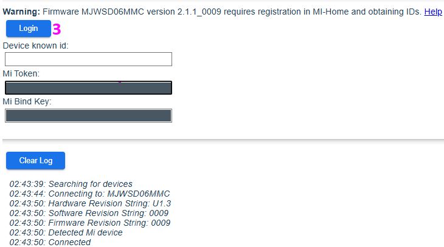
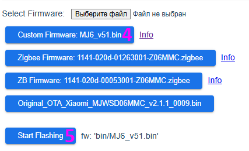
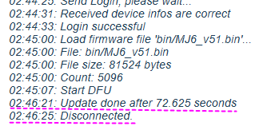
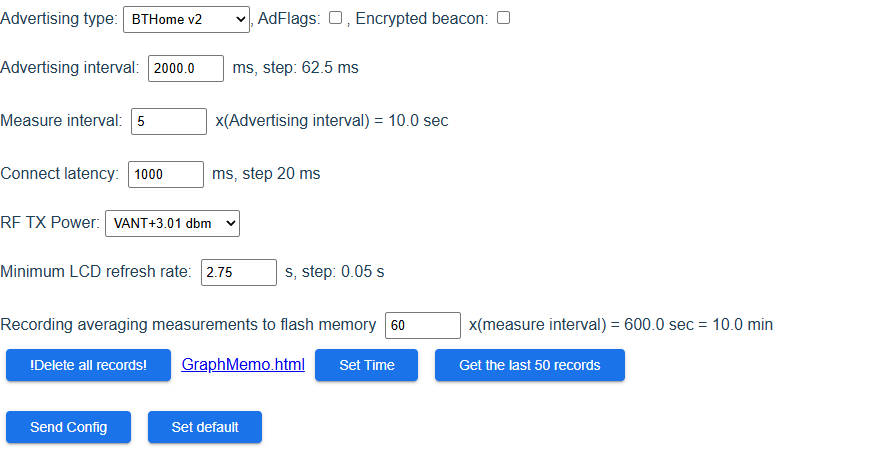
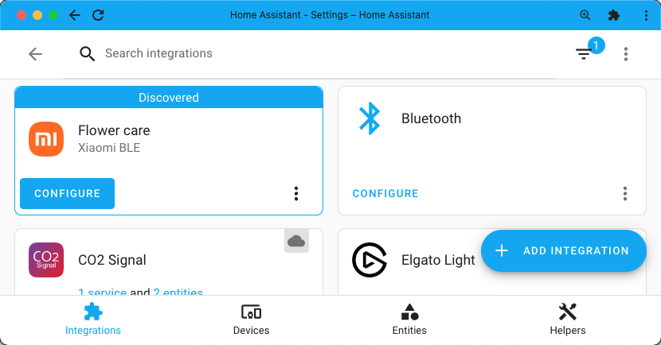
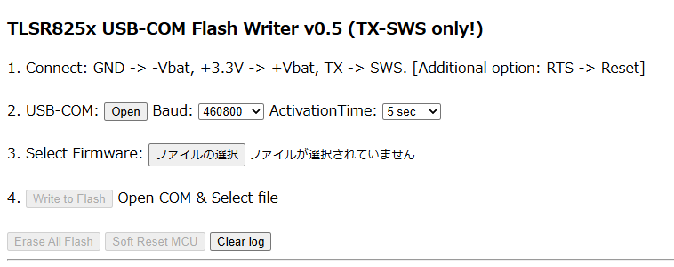

# Bluetooth温湿度計をBTHome化する

[手順の概要](./overview.ja.md) · [English guide](./overview.en.md)

Bluetooth温湿度計にpvvxファームウェアを書き込み、温度と湿度をBTHome v2でHome Assistantに取り込む手順です。純正ファームウェアへ書き戻す方法は手順5にあります。

## この温湿度計を選んだ理由

使ったのは **Xiaomi スマート温湿度計 3 Mini**（型番 `MJWSD06MMC`、製品番号 `QBH4312GL`）です。選定時に、日本国内で入手しやすく、技適マークを確認できる候補を比較したところ、この製品が最も安価でした。 [Xiaomi公式仕様](https://www.mi.com/jp/product/xiaomi-smart-temperature-and-humidity-monitor-3-mini/specs/)・[技適表示が掲載された取扱説明書](https://www.mi.com/jp/support/user-guide-pdf/xiaomi-%E3%82%B9%E3%83%9E%E3%83%BC%E3%83%88%E6%B8%A9%E6%B9%BF%E5%BA%A6%E8%A8%88-3-mini/)

## BTHome化した理由

純正ファームウェアでは、この環境でXiaomi Homeを頻繁に操作する必要がありました。普段の測定値の確認をHome Assistantにまとめるため、Bluetoothでセンサーの測定値を送る公開仕様の **BTHome** に切り替えました。書き換え後は、温湿度計の測定値をHome AssistantのBTHome統合で直接受信します。 [BTHomeの仕様](https://bthome.io/)・[Home AssistantのBTHome統合](https://www.home-assistant.io/integrations/bthome/)

## 実機で確認したこと

2026年11月25日、実機の `MJWSD06MMC`（ハードウェア `V1.3`、純正ファームウェアとソフトウェアのリビジョンはいずれも `0009`）に、pvvxの `MJ6_v59.bin` をBluetoothで書き込みました。Home AssistantにBTHome機器として追加し、温度と湿度が更新されることを確認しました。今回の作業では、この個体の純正ファームウェアのバックアップを省略しました。純正への書き戻しは未検証です。 [実機の確認記録](./overview.ja.md)

各図のキャプションに撮影元と撮影条件を記載しています。

## 0. 準備する

| 用意するもの | 確認する内容 |
| --- | --- |
| 温湿度計 | 型番が `MJWSD06MMC` で、液晶に温湿度が表示されることを確認します。複数台あるときは、対象のBluetoothアドレスを、既存の検出情報などで控えます。 |
| スマートフォン | Xiaomi Homeを使える状態にし、対象機器を登録するXiaomiアカウントと地域を確認します。 |
| Windows PC | 認証情報の抽出とファームウェアの書き込みに使います。Bluetoothをオンにし、ChromeかEdgeを使います。 |
| Home Assistant | 稼働中の環境と、使える状態のBluetooth連携を用意します。受信にはHome Assistant側のBluetoothアダプターまたは対応するBluetoothプロキシを使います。 |

Windows 11では **設定 → Bluetooth とデバイス → デバイス** を開くとBluetoothの状態を確認できます。温湿度計の書き込み用の接続は、手順2でFlasherから行います。 [Home AssistantのBluetooth受信環境](https://www.home-assistant.io/connectivity/bluetooth/)

*図1　Computer Useで撮影したWindows 11の設定画面。PC名を伏せ、Bluetoothの状態が見える部分を掲載しています。*

## 1. 純正ファームウェアの認証情報を取得する

### 1.1 Xiaomi Homeに温湿度計を登録する

1. スマートフォンを温湿度計に近づけ、**Xiaomi Home** を開きます。すでに対象の温湿度計が登録されている場合は、その登録を使って1.2へ進みます。
2. 右上の **＋** から機器追加に進み、検出された **Xiaomi Smart Temperature and Humidity Monitor 3 Mini** を選びます。
3. アプリの案内に従って登録します。本体のボタンを押すように表示されたら、側面のボタンを短く押します。約7秒の長押しは初期化操作です。
4. 登録の完了後、追加された機器の詳細を開き、対象の温湿度計であることを確かめます。 [Xiaomi公式FAQ](https://www.mi.com/global/support/faq/details/KA-573296/)

*図2　Xiaomi公式FAQの画面例。＋から機器追加を開き、検出された3 Miniを選びます。*

### 1.2 Xiaomi Cloud Tokens Extractorで値を取得する

1. Windowsのブラウザーで **Xiaomi Cloud Tokens Extractor v1.5.1** のリリースを開き、**Assets** の **`token_extractor.exe`** をダウンロードします。 [v1.5.1リリース](https://github.com/PiotrMachowski/Xiaomi-cloud-tokens-extractor/releases/tag/v1.5.1)

   

   *図3　リリースページを今回撮影した画像。Assetsの先頭からWindows用ファイルを取得します。*

2. `token_extractor.exe` を起動します。`p/q:` と表示されたら `q` を入力し、Enterを押します。
3. 表示されたQRコードをスマートフォンで読み取り、温湿度計を登録したものと同じXiaomiアカウントでサインインを承認します。
4. `Select server` と表示されたら、Xiaomi Homeで使っている地域に対応するコードを入力します。コードが分からない場合は、何も入力せずEnterを押すとツールが利用可能な全地域を調べます。
5. 結果の `MAC` を控えておいたBluetoothアドレスと照合します。同じ機器の欄にある `TOKEN` と `BLE KEY` を控えます。複数台ある場合は `NAME` も照合に使います。対象を特定できるまでキーの入力には進みません。 [v1.5.1の操作と出力項目](https://github.com/PiotrMachowski/Xiaomi-cloud-tokens-extractor/blob/v1.5.1/token_extractor.py)

Bluetoothアドレスをまだ控えていない場合は、Home Assistantの **Bluetooth Advertisement Monitor** を開き、対象機器が送っている配信のアドレスを確認できます。温湿度計を受信機の近くに置き、本体の側面ボタンを短く押してから探します。 [Advertisement Monitorの開き方](https://www.home-assistant.io/connectivity/bluetooth/#advertisement-monitor)

| Extractorの項目 | 形式 | 入力先 |
| --- | --- | --- |
| `TOKEN` | 16進数24文字 | Flasherの **Mi Token** |
| `BLE KEY` | 16進数32文字 | Flasherの **Mi Bind Key** |

値だけをコピーします。認証に使うQRコード、キー、抽出結果の全文は手元で管理し、スクリーンショットや公開ログに含めないでください。機器を初期化して再登録した場合は、認証情報を取り直します。 [初期化後にキーを取り直した開発元スレッドの報告](https://github.com/pvvx/ATC_MiThermometer/issues/636)

## 2. pvvxファームウェアを書き込む

### 2.1 対象機器と復旧方法を確認する

**対応するファームウェアと復旧方法を確認できてから、書き込みに進んでください。** 開発元の基板資料には、同じ型番でも異なる温湿度センサーを搭載した基板が掲載されています。また、`V1.3` と `0009` がログに出た機器でのGATT接続エラーや、書き込み後に液晶が消えてBluetoothで見つからなくなった事例があります。書き換える前に、純正状態の機器情報を控え、手順5で純正に戻す条件と方法を確認します。無線で接続できなくなると、復旧にケースの分解と基板への配線が必要になる場合があります。 [基板の種類](https://pvvx.github.io/MJWSD06MMC/)・[OTA手順と接続事例](https://github.com/pvvx/ATC_MiThermometer/issues/636)・[無応答になった事例](https://github.com/pvvx/ATC_MiThermometer/discussions/814)・[開発元の有線書き込みツール](https://pvvx.github.io/ATC_MiThermometer/USBCOMFlashTx.html)

| 照合する項目 | このリポジトリの実機で確認した値 |
| --- | --- |
| Bluetoothの型番 | `MJWSD06MMC` |
| ハードウェアリビジョン | `V1.3` |
| ファームウェアとソフトウェアのリビジョン文字列 | いずれも `0009` |
| 純正のBluetooth配信に含まれるXiaomi MiBeacon製品ID | `0x5BEA` |

`0009` は、開発元が案内する純正 `2.1.1_0009` からのOTA手順と一致するリビジョン文字列です。リポジトリの実機では、Xiaomi Homeに表示される完全な版数は未確認です。`0x5BEA` は配信上の製品IDなので、基板の種類は機器の情報と開発元資料で照合します。 [実機の確認記録](./overview.ja.md)・[開発元のOTA手順](https://github.com/pvvx/ATC_MiThermometer/issues/636)

### 2.2 Flasherで接続し、認証する

**Flasher** は、ブラウザーからBluetoothで温湿度計に接続し、ファームウェアの書き込みや測定値の配信形式の設定を行うpvvxのWebツールです。

1. 温湿度計をWindows PCの近くに置き、スマートフォンのXiaomi Homeで温湿度計の詳細画面を閉じます。
2. ChromeまたはEdgeで **pvvx Telink BLE OTA Flasher** を開き、**BLE device name prefix filter(s)** に `MJWSD06MMC` を入力します。 [Flasherを開く](https://pvvx.github.io/ATC_MiThermometer/TelinkMiFlasher.html)

   

   *図4　今回撮影したFlasher v14.4の接続前画面。型番を指定した状態です。*

3. **Connect** を押し、ブラウザーのBluetoothデバイス選択ダイアログで手元の `MJWSD06MMC` を選びます。見つからない場合は、温湿度計の側面ボタンを短く押してから検索をやり直します。 [側面ボタンの動作](https://www.mi.com/global/support/faq/details/KA-573296/)
4. 接続ログで `MJWSD06MMC` と、`Hardware Revision String`、`Firmware Revision String`、`Software Revision String` を確認します。対象やリビジョンが想定と違う場合、または接続エラーが出る場合は、ここで止めます。
5. **Mi Token** に `TOKEN`（24文字）、**Mi Bind Key** に `BLE KEY`（32文字）を入力します。この手順では **Device known id** は空欄のままです。
6. **Login** を押し、ログの `Login successful` を確認します。認証欄が表示されない場合やログインが成功しない場合は、ファイル選択や書き込みに進まず、手順4を参照します。 [開発元のOTA手順](https://github.com/pvvx/ATC_MiThermometer/issues/636)

*図5　pvvxの掲載例。認証情報を伏せています。認証する前に、下部の接続ログで機器とリビジョンを照合します。* [画像の掲載元](https://github.com/pvvx/ATC_MiThermometer/issues/636)

### 2.3 Bluetooth用イメージを選んで書き込む

1. `Login successful` を確認後、互換性を確認した **`MJ6_vNN.bin`** を読み込みます。**Custom Firmware** に目的のファイル名が表示される場合は、そのボタンを使えます。手元のファイルを使う場合は、pvvxプロジェクトのBLE OTA用バイナリを取得して **Select Firmware** で指定します。`NN` はバージョン番号です。画面に並ぶ **Zigbee Firmware**、**ZB Firmware**、**Original OTA** は別の用途の項目です。 [pvvxのBLE OTAファイル案内](https://github.com/pvvx/ATC_MiThermometer#firmware-binaries)・[ファームウェア一覧](https://github.com/pvvx/ATC_MiThermometer/blob/master/firmware.json)
2. **Start Flashing** の横に、読み込んだファイル名が目的の `MJ6_vNN.bin` として表示されていることを確認します。確認できたら **Start Flashing** を押します。

   

   *図6　pvvxの掲載例。`MJ6_v51.bin` はこの画像で使われた版です。作業時は手順2.1で対応を確認した版を選びます。* [画像の掲載元](https://github.com/pvvx/ATC_MiThermometer/issues/636)

3. 書き込みが終わるまで、温湿度計の電池を抜かず、PCの近くに置いたままFlasherのページを開いておきます。
4. ログに `Update done after … seconds` が出たことを確認し、機器の再起動を待ちます。更新後は、手順3.1で `MJ6_…` が検出されることまで確認します。途中でエラーが出た場合や再起動後に機器の応答がない場合は、手順4を参照します。

   

   *図7　pvvxの掲載例。`Update done` が書き込み完了の目印です。* [画像の掲載元](https://github.com/pvvx/ATC_MiThermometer/issues/636)

## 3. BTHome v2を設定し、Home Assistantに追加する

### 3.1 配信形式をBTHome v2にする

1. Flasherの **BLE device name prefix filter(s)** を `MJ6` に設定し、**Connect** から再起動後の `MJ6_…` を選びます。周囲に同型機がある場合は、対象機器を特定してから接続します。 [開発元の再接続手順](https://github.com/pvvx/ATC_MiThermometer/issues/636)
2. **Configuration** の **Advertising type** を **BTHome v2** にします。
3. キー入力なしで使う場合は **Encrypted beacon** のチェックを外します。暗号化を外すと、Bluetoothの電波が届く範囲で第三者も測定値を読み取れます。暗号化を使う場合は有効にし、Flasherの **Get BindKey** で取得できるBTHomeのキーを管理します。Home Assistantで求められる形式は16進数32文字です。 [BTHome v2仕様](https://bthome.io/format/)・[Home AssistantのBTHome暗号化](https://www.home-assistant.io/integrations/bthome/#bindkey)
4. **Send Config** で設定を送信し、Flasher上部の **Disconnect** で切断します。設定の保持を確認する場合は再接続して表示を読み直し、確認後にもう一度切断します。 [Flasher](https://pvvx.github.io/ATC_MiThermometer/TelinkMiFlasher.html)

*図8　Flasher v14.4の表示を、実機に接続せずテスト値で再現して撮影した画像。操作するのは配信形式、暗号化、設定送信の3か所です。*

### 3.2 Home AssistantにBTHome機器を追加する

1. 温湿度計をHome Assistant側のBluetoothアダプターか対応プロキシの近くに置きます。
2. Home Assistantで **設定 → デバイスとサービス → 統合** を開きます。**検出済み** に対象の **BTHome** 機器が表示されたら **追加** を押します。
3. **検出済み** にカードが出ていない場合は、右下の **統合を追加** から `BTHome` を検索します。候補が表示されたら対象機器を選び、画面の案内に従います。候補がない場合は、手順4で受信と配信設定を確認します。
4. 暗号化を有効にした場合は、求められたときに3.1で確認したBTHomeのキーを入力します。画面に名前やエリアの設定が出たら、任意の名前と設置場所を設定して完了します。 [Home AssistantのBTHomeセットアップ](https://www.home-assistant.io/integrations/bthome/)・[統合の追加手順](https://www.home-assistant.io/getting-started/integration/)

*図9　Home Assistant公式の統合画面例（2022.8）。例に写る機器はFlower careです。検出済みカードと右下の追加ボタンの位置を確認できます。ボタンの表記はバージョンや表示言語で変わります。* [画像の掲載元](https://www.home-assistant.io/blog/2022/08/03/release-20228/#first-class-bluetooth-support)

### 3.3 測定値の更新を確認する

1. **設定 → デバイスとサービス → デバイス** から追加した温湿度計を開きます。
2. 温度と湿度のエンティティに数値が出ていることを確認し、本体の液晶表示と照合します。バッテリー残量が配信されている場合は、その値も確認します。
3. 温湿度が少し変わるのを待ち、液晶に変化が出た後にHome Assistant側も更新されることを確認します。
4. 温湿度計を実際の設置場所に移し、同じように更新されることを確認します。設置場所で値が更新されるところまでが完了の目安です。

実機では、書き込み後の再起動でHome AssistantがBTHome機器を自動検出しました。`MJ6 D95B` として追加したあと、次のとおり温度と湿度の両方が変化しました。時刻は2026年11月25日の日本時間です。

| 測定項目 | 06:01:05 | 06:01:30 |
| --- | --- | --- |
| 温度 | 27.48 °C | 27.43 °C |
| 湿度 | 45.49% | 45.53% |

## 4. つまずいたときの確認箇所

| 症状 | 切り分けと対処 |
| --- | --- |
| Extractorに温湿度計が出ない | Xiaomi Homeで登録したアカウントと地域を照合します。登録先が分からない場合は `Select server` で空欄のままEnterを押し、対象の `MAC` を探します。 |
| Flasherのデバイス一覧に出ない | PCのBluetooth、距離、名前フィルターを確認します。純正時は `MJWSD06MMC`、書き込み後は `MJ6` で絞ります。純正時はXiaomi Homeの詳細を閉じ、本体のボタンを短く押してから検索します。 |
| 接続ログにGATTエラーが出る | 失敗した段階と機器のリビジョンを控えます。`V1.3` / `0009` で同様の報告があり、開発元はFlasherを実行する端末を変えて試すよう案内しています。接続と認証の両方が成功するまで書き込みには進みません。 [開発元の接続事例](https://github.com/pvvx/ATC_MiThermometer/issues/636) |
| ログイン時に `Not registered!` が出る | Xiaomi Homeに対象機器が登録されているか、取得したキーが同じ機器のものか確認します。初期化や再登録後は、現在の登録から認証情報を取得し直します。 [開発元スレッドの事例](https://github.com/pvvx/ATC_MiThermometer/issues/636) |
| 書き込み後に液晶が点かず、Bluetoothでも見つからない | 書き込みの完了ログ、液晶の状態、電源を確認します。無応答が続く場合は、5.2の「Bluetoothで接続できない場合」を参照します。 [開発元の基板資料](https://pvvx.github.io/MJWSD06MMC/)・[報告例](https://github.com/pvvx/ATC_MiThermometer/discussions/814) |
| BTHome機器が見つからない、または温湿度が更新されない | Flasherが切断済みか確認し、次に温湿度計をHome Assistant側の受信機へ近づけます。それでも更新されない場合は `BTHome v2` が保存されているか、暗号化の設定とHome Assistantのキーが対応しているかを確認します。 [Home AssistantのBluetooth受信ガイド](https://www.home-assistant.io/connectivity/bluetooth/)・[BTHomeの設定](https://www.home-assistant.io/integrations/bthome/) |

## 5. 純正ファームウェアに戻す

Flasherで `MJ6_…` に接続でき、ファームウェアの選択欄まで表示される場合は5.1へ進みます。電池、PCのBluetooth、距離、他のアプリとの接続を確認してもFlasherで接続できない場合は、5.2の有線復旧が候補です。どちらも開発元の資料に基づく手順で、このリポジトリの実機での書き戻しは未検証です。

### 5.1 Bluetoothで接続できる場合

1. 書き換え前に控えた型番とリビジョンを確認します。pvvxが公開しているこの型番の純正OTA用ファイルは `Original_OTA_Xiaomi_MJWSD06MMC_v2.1.1_0009.bin` です。公開ファイル一覧のハードウェア表記は `U1.3` で、開発元のフラッシュ構成資料とこのリポジトリの実機記録には `V1.3` の表記があります。書き換え前の版数と基板を照合し、ファイルが対象機器に適合することを確認してから進みます。 [純正OTAファイル一覧](https://github.com/pvvx/ATC_MiThermometer/blob/master/bin/Original/README.md)・[機種別のフラッシュ構成](https://github.com/pvvx/ATC_MiThermometer/blob/master/src/app_config.h#L2630-L2639)
2. WindowsのChromeかEdgeでFlasherを開きます。名前フィルターを `MJ6` にし、**Connect** から対象を選びます。pvvxファームウェアで接続したまま、ファームウェア選択欄へ進みます。 [Flasherを開く](https://pvvx.github.io/ATC_MiThermometer/TelinkMiFlasher.html)
3. **`Original_OTA_Xiaomi_MJWSD06MMC_v2.1.1_0009.bin`** と表示されたボタンを押します。図6では、このボタンが **Start Flashing** の上にあります。読み込み後、**Start Flashing** の横の `fw:` に同じファイル名が出ていることを確認します。対応ファイルのボタンや書き込みボタンが出ない場合は、書き込む前にファイルの適合とFlasherのログを確認します。 [公開されている純正OTAファイル](https://github.com/pvvx/ATC_MiThermometer/blob/master/bin/Original/Original_OTA_Xiaomi_MJWSD06MMC_v2.1.1_0009.bin)
4. **Start Flashing** を押します。電池を入れたままPCの近くに置き、ログに `Update done after … seconds` が出てから再起動を待ちます。書き込みが終わったら5.3で純正動作を確認します。 [Flasherの実装](https://github.com/pvvx/pvvx.github.io/blob/master/ATC_MiThermometer/TelinkMiFlasher.html)

### 5.2 Bluetoothで接続できない場合

ケースを開け、基板へ直接つないで **Telink SWire** で書き込みます。全領域イメージを書き込むと、プログラムに加え、Bluetoothアドレスや機器固有情報の領域も上書きされます。対象の個体から取得した書き換え前の純正バックアップがあれば優先します。個体情報を残す必要がある場合は、書き込む前に、読み出しに対応するSWireプログラマーで既存の内容を保存します。 [機種別のフラッシュ構成](https://github.com/pvvx/ATC_MiThermometer/blob/master/src/app_config.h#L2630-L2639)・[読み出しに対応するpvvxのツール](https://github.com/pvvx/TlsrComSwireWriter)

同型機で公開の全領域イメージを書き込み、液晶の温湿度表示は復帰したものの、Xiaomi Homeには接続できなかった報告があります。Xiaomi Homeへの再接続まで確認するには、書き込み後に5.3を実施します。 [公開イメージでの復旧報告](https://github.com/pvvx/ATC_MiThermometer/issues/769)

1. 電池を外してケースを開け、基板写真とセンサーチップの刻印を開発元資料と照合します。自分の個体の純正バックアップがない場合は、次の対応で **Original FullFlash** を選び、ZIPを展開します。基板や端子を特定できない場合は配線・書き込みを中断します。 [基板写真とOriginal FullFlash](https://pvvx.github.io/MJWSD06MMC/)

   | 基板上の温湿度センサー | 選ぶZIP | 展開後のファイル |
   | --- | --- | --- |
   | Sensirion SHV4 | `MJWSD06MMC_ff.zip` | `MJWSD06MMC_ff.bin` |
   | GXHT40 | `Firmware_mj6_ff_new.zip` | `Firmware_mj6_ff_new.bin` |

2. 3.3 Vの電源と3.3 Vの信号レベルを使えるUSB–UARTアダプターを用意します。開発元はFTDI系の一部がTelinkの書き込みに適さないと案内しており、この型番ではCH340系で書き込めた報告があります。アダプターをPCから外し、電池を外したまま、`3.3 V` を電池端子の `+Vbat` に、`TX` を基板写真で確認した `S`（`SWS`）に接続します。`GND` 線は手順4で電池端子の `-Vbat` につなげるよう準備します。 [開発元の機種別の配線指示](https://github.com/pvvx/ATC_MiThermometer/issues/809)・[CH340系での書き込み報告](https://github.com/pvvx/ATC_MiThermometer/issues/769)
3. アダプターをPCにつなぎ、ChromeかEdgeで **TLSR825x USB-COM Flash Writer** を開きます。**Open** からアダプターのCOMポートを選び、**Select Firmware** で純正の全領域 `.bin` を選びます。公開の全領域ファイルは、どちらも `524288 bytes` と表示されます。図10の `Baud` と `ActivationTime` は、画面の初期値の `460800` と `5 sec` です。 [USB-COM Flash Writerを開く](https://pvvx.github.io/ATC_MiThermometer/USBCOMFlashTx.html)

   

   *図10　開発元の書き込みツールを今回撮影した画像。ポートとファイルの選択前なので、Write to Flashは押せない状態です。*

4. **Write to Flash** を押し、`Activate` と表示されている間に `GND` を `-Vbat` へつなぎます。そのまま接続を保ち、ログの `Done` と `Soft Reset MCU` を待ちます。**Write to Flash** は対象領域の消去と書き込みを行います。このツールは基板からデータを読み戻さないため、`Done` はPC側の送信処理が終わった目印です。 [開発元の起動手順](https://github.com/pvvx/ATC_MiThermometer#the-usb-com-adapter-writes-the-firmware-in-explorer-web-version)・[書き込みツールの実装](https://github.com/pvvx/pvvx.github.io/blob/master/ATC_MiThermometer/USBCOMFlashTx.html)
5. COMポートを **Close** で閉じ、USB–UARTアダプターをPCから外して配線を取り外したあと、電池を戻します。液晶とBluetoothが復帰したら5.3へ進みます。無応答が続く場合は、基板の種類、選んだファイル、電源と `SWS` の配線を確認します。同型機で有線書き込みを試みても復旧しなかった事例があります。 [同型機の有線復旧の報告](https://github.com/pvvx/ATC_MiThermometer/discussions/749)

### 5.3 純正で起動・通信できることを確認する

1. 液晶に温度と湿度が表示され、本体のボタンを短く押すと `MJWSD06MMC` がBluetoothで検出できることを確認します。純正 `2.1.1_0009` に戻した場合は、Flasherの接続ログでファームウェアとソフトウェアのリビジョン文字列が `0009` であることを確認し、Flasherを切断します。 [本体ボタンの動作](https://www.mi.com/global/support/faq/details/KA-573296/)
2. Xiaomi Homeで温湿度計を開き、近くから接続して測定値が更新されることを確認します。既存の登録で接続できず、再登録が必要な場合は、純正動作を確認したうえで右側ボタンを約7秒押して初期化し、手順1.1で登録し直します。 [Xiaomi公式の登録・初期化手順](https://www.mi.com/global/support/faq/details/KA-573296/)
